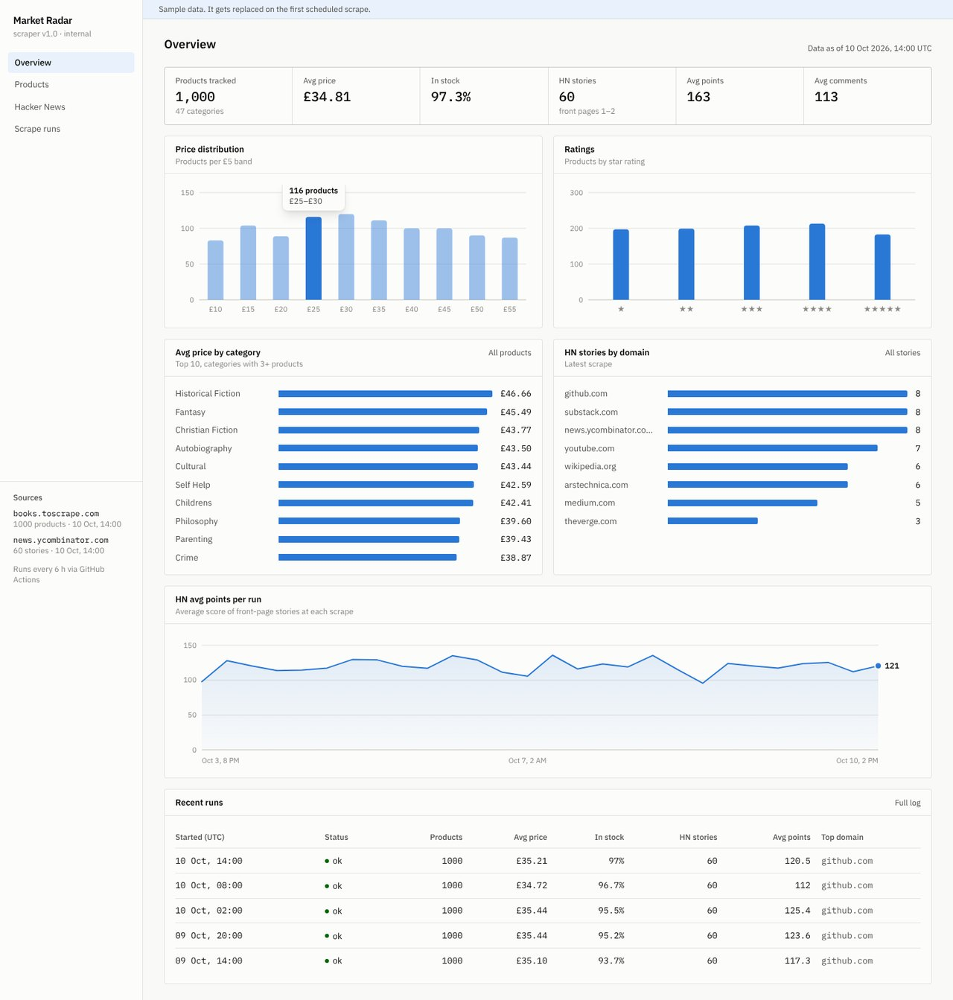
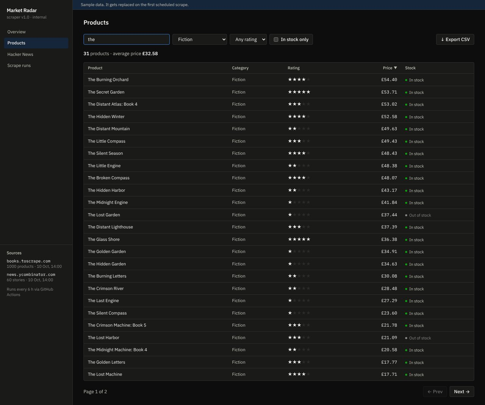
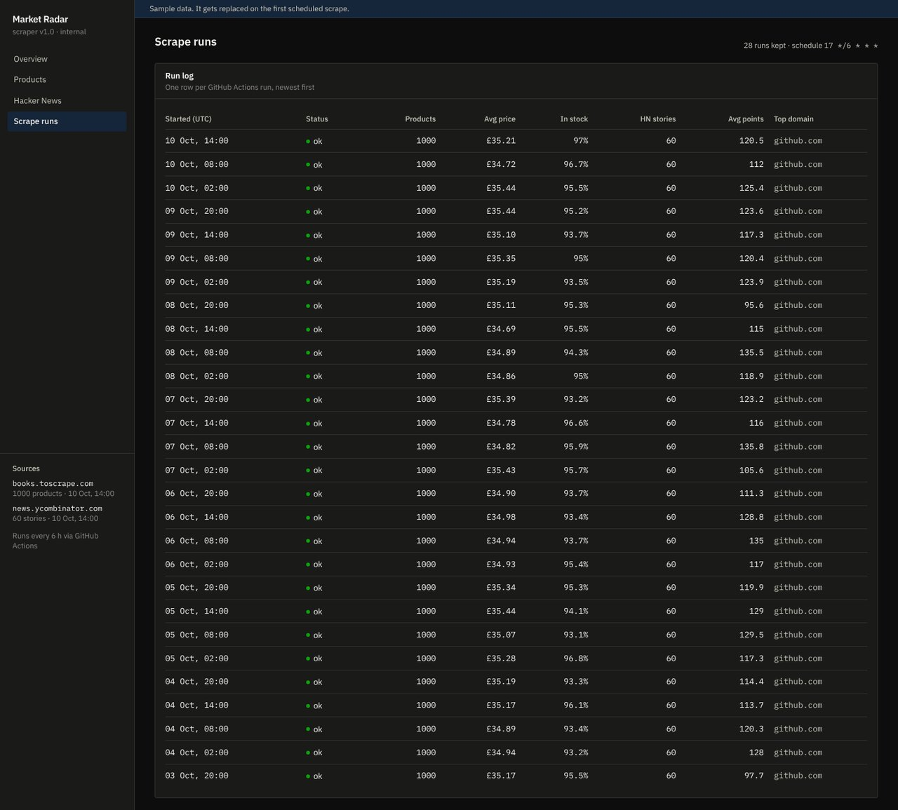
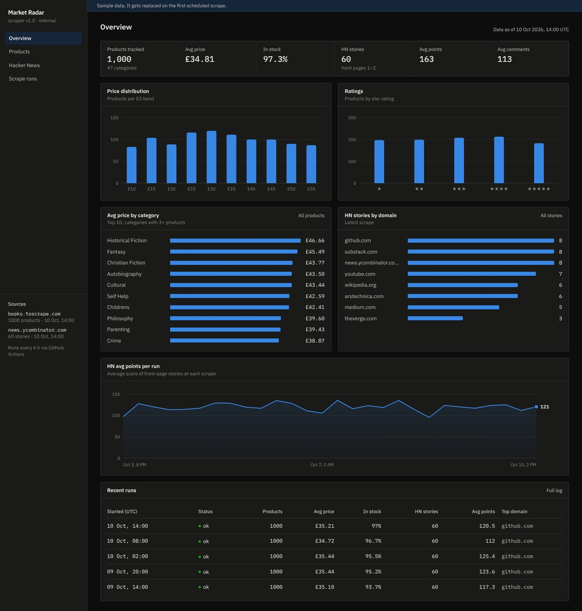

# Market Radar: scraping bot and dashboard

An automated data pipeline that **scrapes websites on a schedule** and publishes the results to a **live analytics dashboard** — at zero hosting cost.

- **Python bot** collects an e-commerce catalogue (1,000 products from [books.toscrape.com](https://books.toscrape.com), a sandbox built for scraping practice) and the [Hacker News](https://news.ycombinator.com) front page.
- **GitHub Actions** runs it every 6 hours and commits fresh JSON/CSV back to the repo.
- **Next.js dashboard** on Vercel redeploys on every commit: KPIs, charts, searchable tables, a run log and CSV export.
- **Telegram alerts** (optional) for price drops and stories going viral.

**Live demo:** `https://YOUR-DASHBOARD.vercel.app`



| Products explorer | Scrape run log | Dark mode |
|---|---|---|
|  |  |  |

## How it works

```
GitHub Actions (cron 6h) ──► python -m scraper ──► data/*.json + data/export/*.csv
                                                        │  git commit & push
                                                        ▼
                                              Vercel rebuilds the dashboard
```

## Scraper highlights

- `requests` + `BeautifulSoup`, connection pooling, **automatic retries with exponential backoff** (429/5xx, honours `Retry-After`)
- **robots.txt aware** — checks permissions and honours `Crawl-delay` automatically; per-host rate limiting
- Crawls all categories, follows pagination, de-duplicates products, normalises price/rating/stock
- Fault-tolerant: one failing source doesn't kill the run; atomic file writes
- Keeps a rolling run history for time-series charts
- Unit tests with HTML fixtures + an end-to-end CLI test (network mocked) — run in CI before every scrape

```bash
pip install -r requirements.txt -r requirements-dev.txt
python -m pytest -q tests          # 6 tests
python -m scraper                  # scrape everything into ./data
python -m scraper --source books --max-categories 3 -v
python -m scraper --source hn --hn-pages 3
```

## Dashboard

Laid out like an internal tool: sidebar navigation, dense tables, IBM Plex Sans/Mono. Next.js 16 · React 19 · TypeScript · Tailwind CSS 4 · hand-built SVG charts (no chart library) with hover tooltips, keyboard focus, light/dark themes and a colour-blind-checked palette.

```bash
npm install
npm run dev        # http://localhost:3000
```

The repo ships with clearly labelled **sample data** so the dashboard renders immediately; the first scheduled scrape replaces it (`python scripts/make_sample_data.py` regenerates it).

## Setup on GitHub

1. Push this repo to GitHub.
2. **Settings → Actions → General → Workflow permissions →** *Read and write permissions*.
3. **Actions → Scrape data → Run workflow** to fetch real data now.
4. (Optional) add `TELEGRAM_BOT_TOKEN` and `TELEGRAM_CHAT_ID` under **Settings → Secrets → Actions** for alerts.
5. Import the repo in Vercel — every data commit redeploys the dashboard.

---
Portfolio project. Scrapes only public pages, identifies itself with a bot User-Agent and respects robots.txt.
